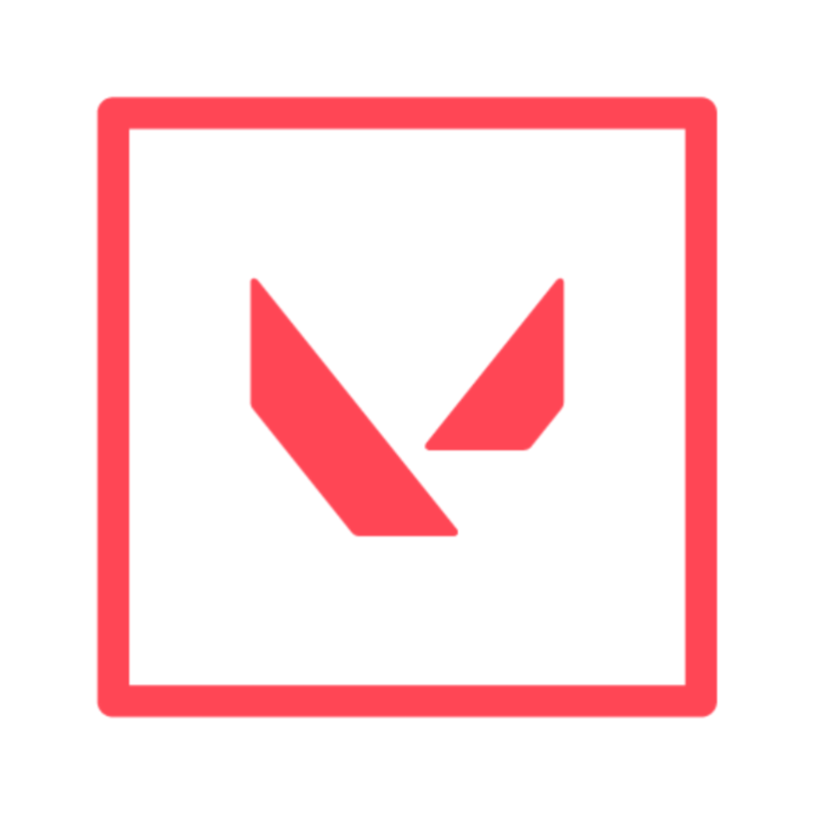
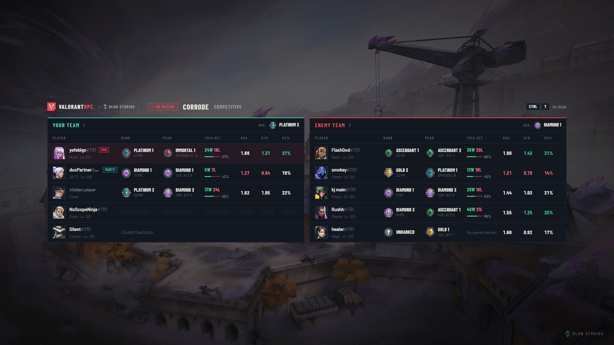
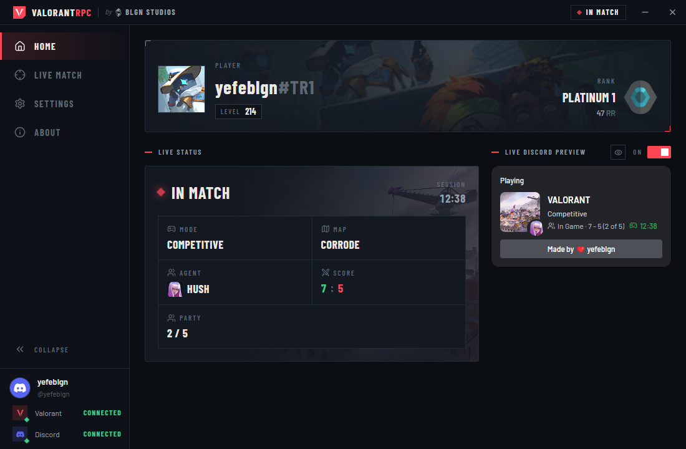
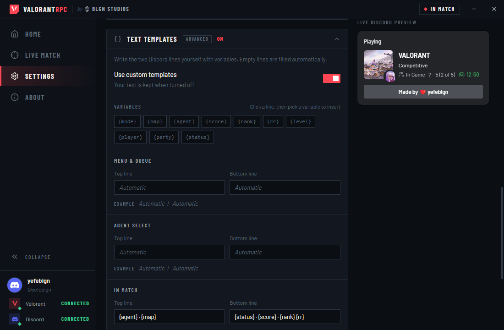
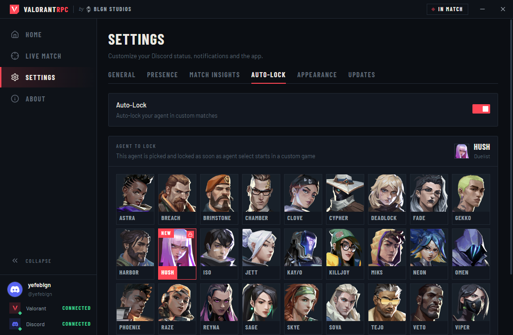

<div align="center">



# ValorantRPC

**Your VALORANT status on Discord, and a live look at everyone in your match.**<br>
Runs entirely on your PC. No API keys, no account login, no servers in between.

<sub>by</sub>&nbsp;
<picture>
  <source media="(prefers-color-scheme: dark)" srcset=".github/assets/blgn-studios-light.png">
  
</picture>
&nbsp;<b>BLGN Studios</b>

<br>

[](https://github.com/yefeblgn/valorantrpc/releases/latest)
[](https://github.com/yefeblgn/valorantrpc/releases)
[](#install)
[](LICENSE)

[](https://github.com/yefeblgn/valorantrpc/releases/latest)
&nbsp;
[](https://github.com/yefeblgn/valorantrpc/releases)
&nbsp;
[](https://github.com/yefeblgn/valorantrpc/issues)

**English** · [Türkçe](README.tr.md)

<br>



<sub>Match Insights, opened with <kbd>Ctrl</kbd> + <kbd>T</kbd> on top of the game</sub>

</div>

<br>

## Features

<table>
  <tr>
    <td width="50%" valign="top">
      <br>
      <b>Rich Presence that follows the game</b><br>
      Menu, queue, agent select, match, the Range and match found each get their own status, with map art, agent portrait, score, rank and RR.
    </td>
    <td width="50%" valign="top">
      <br>
      <b>Match Insights</b><br>
      Rank, peak rank, act record, KDA, K/D and headshot rate for every player, from agent select to the end of the match.
    </td>
  </tr>
  <tr>
    <td valign="top">
      <br>
      <b>In-game panel on a hotkey</b><br>
      Press <kbd>Ctrl</kbd> + <kbd>T</kbd> (or any combo you record) to fade the stats panel in over the game. Press again to hide it.
    </td>
    <td valign="top">
      <br>
      <b>Text templates</b><br>
      Write both Discord lines yourself with variables like <code>{agent}</code>, <code>{map}</code> and <code>{score}</code>. Empty lines stay automatic.
    </td>
  </tr>
  <tr>
    <td valign="top">
      <br>
      <b>Streamer mode</b><br>
      One click hides your name, tag, rank and level on Discord and turns invites off.
    </td>
    <td valign="top">
      <br>
      <b>The Range and queueing from it</b><br>
      Shows <i>In the Range · Warming up</i>, switches to <i>In Queue · Competitive</i> when you queue from the Range, and <i>Match found!</i> when it pops.
    </td>
  </tr>
  <tr>
    <td valign="top">
      <br>
      <b>Discord invites</b><br>
      Invite friends to your VALORANT party from a Discord chat with <b>+ → Invite to play</b>, and accept join requests from the app.
    </td>
    <td valign="top">
      <br>
      <b>Auto-Lock for custom games</b><br>
      Pick an agent from a grid that looks like agent select; it is locked the moment a custom game starts. New agents are tagged.
    </td>
  </tr>
  <tr>
    <td valign="top">
      <br>
      <b>Detection notification</b><br>
      A Windows notification tells you when VALORANT is detected and your status goes live. Click it to open the app.
    </td>
    <td valign="top">
      <br>
      <b>Always current</b><br>
      Agent, map and rank data refresh on their own when the game patches, and the app updates itself from GitHub releases.
    </td>
  </tr>
  <tr>
    <td valign="top">
      <br>
      <b>Local by design</b><br>
      Reads the Riot Client on your machine. Nothing is sent to us or to any third-party server.
    </td>
    <td valign="top">
      <br>
      <b>Seven languages</b><br>
      English, Türkçe, Español, Français, 日本語, 简体中文 and العربية (right-to-left) for the interface and every Discord line; the client language is detected on first launch.
    </td>
  </tr>
  <tr>
    <td valign="top">
      <br>
      <b>Dark, light or system theme</b><br>
      Switch between dark and light, or follow Windows. Pick any accent color.
    </td>
    <td valign="top">
      <br>
      <b>Fixed window sizes</b><br>
      Like a game client, the window keeps a fixed size: 1024×640, 1152×720, 1280×800 or 1440×900. Automatic picks the best fit for your screen.
    </td>
  </tr>
  <tr>
    <td colspan="2" valign="top">
      <br>
      <b>Accessibility</b><br>
      Interface size from 90% to 125%, bold text, high contrast and reduced motion, all under <b>Settings → Appearance</b> without breaking the layout.
    </td>
  </tr>
</table>

<br>

## Match Insights

Match Insights shows who you are playing with and against, the way tracker sites do, without leaving the game.

- **Agent select:** your team appears as soon as the lobby forms. Rows update as players hover and lock agents.
- **In match:** both teams are listed side by side. Teams show their average rank.
- **Agent select HUD:** a compact card shows your team's ranks, act win rate and K/D, plus your three most played agents on the current map with their win rates. It appears on its own during agent select, no hotkey needed. The cursor is free in agent select, so you can click a player for their peak, act record, KDA and level, copy their Riot ID, drag the card by its header, shrink it to just your best agents or close it for the match, all without taking focus from the game. Position, size and background are set in **Settings → Match Insights**, with a live preview.
- **Where:** in the **Live Match** page of the app, and in the in-game panel you open with the hotkey.

| Column | What it shows |
| --- | --- |
| **Rank** | Current rank and RR in this act |
| **Peak** | Highest rank ever reached and the act it happened in. Old Immortal ranks are mapped to today's tiers |
| **This Act** | Wins, losses and win rate this act |
| **KDA** | (Kills + Assists) / Deaths over the last 3 competitive matches |
| **K/D** | Kills / Deaths over the last 3 competitive matches |
| **HS%** | Headshot rate over the last 3 competitive matches |

Your row is marked **YOU** and your party members **PARTY**. Players who turned on Riot's *hide my name* setting stay hidden: you see their agent, never their Riot ID.

**Hotkey.** <kbd>Ctrl</kbd> + <kbd>T</kbd> by default. To change it, open **Settings → Match Insights**, click the hotkey box and press the keys you want. Combinations like <kbd>Alt</kbd> + <kbd>Q</kbd> work, and so do single keys such as <kbd>F6</kbd>, <kbd>Insert</kbd> or <kbd>Home</kbd>. <kbd>Esc</kbd> cancels. The hotkey is only active while VALORANT is the window in front, so it never opens the panel over your desktop or steals the combination from other apps.

> [!IMPORTANT]
> The panel and the HUD follow the game's window and scale with its resolution, in both **Fullscreen** and **Windowed Fullscreen**. If they stay hidden in Fullscreen, check that fullscreen optimizations are not turned off for `VALORANT-Win64-Shipping.exe` (Properties → Compatibility), or switch to Windowed Fullscreen.

> [!WARNING]
> Match Insights is **off by default**. Riot's developer policy is against tools that show other players' stats without their consent, and there have been reports of temporary penalties for using tracker apps during matches. Turning it on is your decision and your responsibility.

<br>

## Career

The **Career** page keeps your own match history on this PC, so it works even when VALORANT and the Riot Client are closed. The first time, your last 100 matches are read in the background; after that new matches are added as soon as a game ends, and **Load older matches** goes further back.

- **Matches:** a list like the in-game career tab, grouped by day, with map, agent, score, K/D/A, ACS, HS% and RR change. Open one for the full scoreboard (ACS, ADR, HS%, first kills and deaths, multi-kills), a round-by-round timeline with how each round ended, spike plants and defuses, the kill feed and every player's loadout, and a minimap of kills, deaths and plants for that match or your last matches on the map. **Copy image** puts a scoreboard picture on your clipboard for Discord.
- **Agents:** matches, win rate, K/D, KDA, ACS, ADR, HS%, first kill rate, ability casts and a per-map breakdown for every agent you play.
- **Weapons:** kills, kills per round, HS%, damage per round and what kills you most.
- **Analysis:** pistol, eco, force and full-buy win rates, attack and defense, opening duels, clutches from 1v1 to 1v5 and personal records.
- **Rank:** RR over time with promotions marked, recent RR changes and a rank goal with an estimate of how many matches it may take.

The home page shows **this session** (wins, losses, net RR, ACS and K/D) and your **last match**. After each match a notification sums it up, and an optional reminder suggests a short break after a losing streak. Both are in **Settings → History**, together with backup export and import.

History lives in `%APPDATA%\ValorantRPC\data`. Updates and reinstalls keep it; only deleting that folder removes it.

<br>

## Discord presence

| Where you are | Top line | Bottom line |
| --- | --- | --- |
| Menu | Competitive | In Queue |
| Agent select | Selecting Agent | Hush |
| In match | Competitive | In Game · 7 - 5 |
| The Range | In the Range | Warming up |
| Queueing from the Range | In the Range | In Queue · Competitive |
| Match found | Competitive | Match found! |

The large image switches between your player card, map art and mode art. The small image shows your agent or rank. Every slot can be fixed to something else under **Settings → Presence**.

### Text templates

Turn on **Settings → Presence → Text templates** to write the lines yourself for each state (menu, agent select, match, the Range). Click a line, then click a variable to insert it. If a variable is empty at that moment, the separator next to it is removed so the line still reads cleanly.

| Variable | Turkish alias | Example |
| --- | --- | --- |
| `{mode}` | `{mod}` | Competitive |
| `{map}` | `{harita}` | Corrode |
| `{agent}` | `{ajan}` | Hush |
| `{score}` | `{skor}` | 7 - 5 |
| `{rank}` | `{rank}` | Platinum 1 |
| `{rr}` | `{rr}` | 47 RR |
| `{level}` | `{seviye}` | 214 |
| `{player}` | `{oyuncu}` | Name#TAG |
| `{party}` | `{parti}` | 2/5 |
| `{status}` | `{durum}` | In Game |
| `{session}` | `{oturum}` | 4W 2L · +38 RR |

Example: `{agent} · {map}` on top and `{status} · {score}` below gives **Hush · Corrode** / **In Game · 7 - 5**.

<br>

## Screenshots

<table>
  <tr>
    <td width="50%"></td>
    <td width="50%"></td>
  </tr>
  <tr>
    <td align="center"><sub>Home: player card, live status and Discord preview</sub></td>
    <td align="center"><sub>Text templates with live examples</sub></td>
  </tr>
  <tr>
    <td colspan="2"></td>
  </tr>
  <tr>
    <td colspan="2" align="center"><sub>Auto-Lock agent grid</sub></td>
  </tr>
</table>

<br>

## Install

1. Download **ValorantRPC-Setup-x.y.z.exe** (installer) or **ValorantRPC-x.y.z-portable.exe** from the [latest release](https://github.com/yefeblgn/valorantrpc/releases/latest).
2. Open the **Discord desktop app**. The browser version of Discord cannot show game activity.
3. Start ValorantRPC, then launch VALORANT. Your status appears on its own.

Requirements: Windows 10 or 11, VALORANT, Discord desktop.

> [!NOTE]
> The installer is not code-signed, so Windows SmartScreen may show a warning the first time. Choose **More info → Run anyway**.

<br>

## How it works

- The Riot Client writes a local `lockfile`. ValorantRPC reads it to talk to the client's local API on `127.0.0.1`, the same way the game itself does.
- Your status comes from your own Riot session. Match Insights and Career use the same session to read ranks and match history from Riot's game services; your history is then stored only on this PC.
- Agent names, map art and rank icons come from the public [valorant-api.com](https://valorant-api.com) and are cached locally.
- Discord is updated over its local IPC pipe.

There is no ValorantRPC server, no analytics and no telemetry.

<br>

## Troubleshooting

<details>
<summary><b>My status does not show on Discord</b></summary>

Make sure the Discord desktop app is running, and that **User Settings → Activity Privacy → Share your detected activities with others** is on. Check that **Rich Presence** is on in the app's home page.
</details>

<details>
<summary><b>The in-game panel does not appear</b></summary>

Make sure Match Insights is turned on and VALORANT is the window in front. If you play in Fullscreen, check that fullscreen optimizations are not turned off for VALORANT, or switch to Windowed Fullscreen.
</details>

<details>
<summary><b>The hotkey does nothing</b></summary>

Another program may already use that combination. The settings page shows a warning when the hotkey cannot be registered. Pick a different one.
</details>

<details>
<summary><b>A player shows "Couldn't load stats"</b></summary>

Riot limits how many requests can be made in a short time, and brand-new accounts may have no ranked data. The app retries after a minute.
</details>

<details>
<summary><b>A player shows "Hidden player"</b></summary>

That player turned on Riot's setting to hide their name. ValorantRPC respects it and never looks their name up.
</details>

<br>

## Build from source

Requires Node.js 18 or later.

```bash
npm install
```

```bash
npm run dev
```

```bash
npm run dist
```

`npm run dist` writes the installer and the portable build to `release/`.

Built with Electron, React, TypeScript, Vite and Tailwind CSS.

<br>

## License

[MIT](LICENSE) © 2026 BLGN Studios

<sub>ValorantRPC isn't endorsed by Riot Games and doesn't reflect the views or opinions of Riot Games or anyone officially involved in producing or managing Riot Games properties. Riot Games and all associated properties are trademarks or registered trademarks of Riot Games, Inc.</sub>
