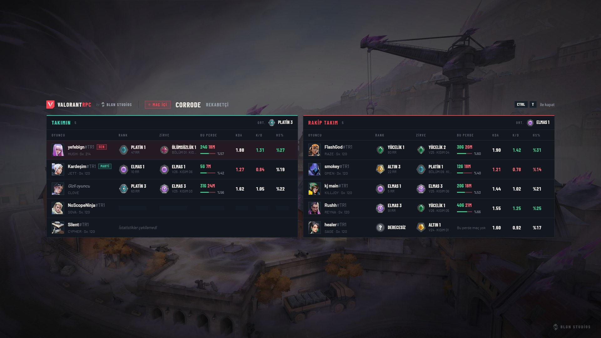
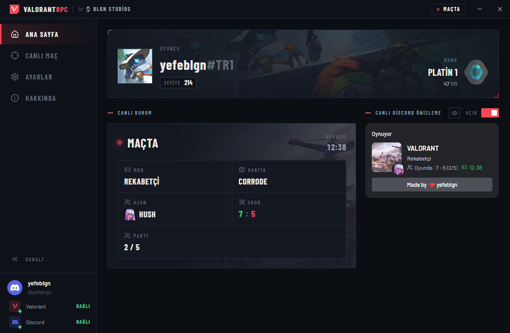
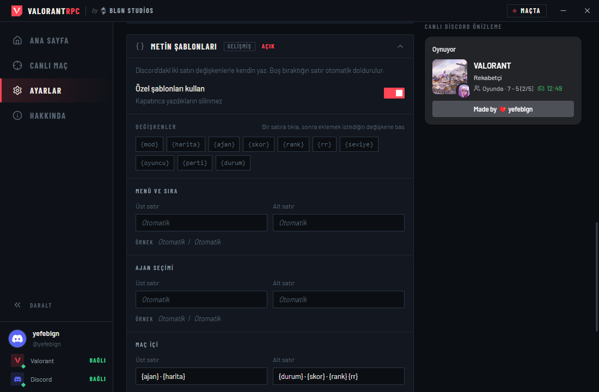
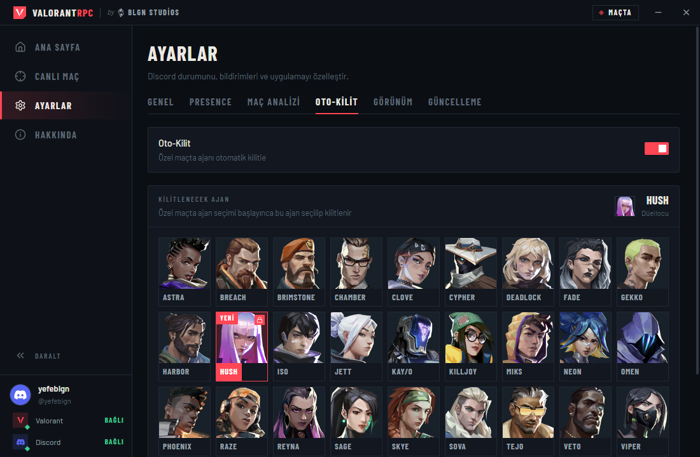

<div align="center">


# ValorantRPC

**VALORANT durumun Discord'da, maçındaki herkes bir tuş uzağında.**<br>
Tamamen senin bilgisayarında çalışır. API anahtarı, hesap girişi ya da aracı sunucu yok.

<sub>by</sub>&nbsp;
<picture>
  <source media="(prefers-color-scheme: dark)" srcset=".github/assets/blgn-studios-light.png">
  
</picture>
&nbsp;<b>BLGN Studios</b>

<br>

[](https://github.com/yefeblgn/valorantrpc/releases/latest)
[](https://github.com/yefeblgn/valorantrpc/releases)
[](#kurulum)
[](LICENSE)

[](https://github.com/yefeblgn/valorantrpc/releases/latest)
&nbsp;
[](https://github.com/yefeblgn/valorantrpc/releases)
&nbsp;
[](https://github.com/yefeblgn/valorantrpc/issues)

[English](README.md) · **Türkçe**

<br>



<sub>Oyunun üstünde <kbd>Ctrl</kbd> + <kbd>T</kbd> ile açılan Maç Analizi</sub>

</div>

<br>

## Özellikler

<table>
  <tr>
    <td width="50%" valign="top">
      <br>
      <b>Oyunu takip eden Rich Presence</b><br>
      Menü, sıra, ajan seçimi, maç, poligon ve maç bulundu durumlarının her biri harita görseli, ajan portresi, skor, rank ve RR ile ayrı gösterilir.
    </td>
    <td width="50%" valign="top">
      <br>
      <b>Maç Analizi</b><br>
      Ajan seçiminden maç sonuna kadar her oyuncunun rankı, zirve rankı, perde kaydı, KDA, K/D ve kafa isabet oranı.
    </td>
  </tr>
  <tr>
    <td valign="top">
      <br>
      <b>Kısayolla oyun içi panel</b><br>
      <kbd>Ctrl</kbd> + <kbd>T</kbd> (ya da kendi kaydettiğin kısayol) paneli oyunun üstünde yumuşakça açar; tekrar basınca kapanır.
    </td>
    <td valign="top">
      <br>
      <b>Metin şablonları</b><br>
      Discord'daki iki satırı <code>{ajan}</code>, <code>{harita}</code>, <code>{skor}</code> gibi değişkenlerle kendin yaz. Boş bıraktığın satır otomatik kalır.
    </td>
  </tr>
  <tr>
    <td valign="top">
      <br>
      <b>Yayıncı modu</b><br>
      Tek tıkla Discord'da adını, etiketini, rankını ve seviyeni gizler; davetleri kapatır.
    </td>
    <td valign="top">
      <br>
      <b>Poligon ve poligondan sıraya girme</b><br>
      <i>Poligonda · Isınıyor</i> yazar, poligondan sıraya girince <i>Sırada · Rekabetçi</i>, maç bulununca <i>Maç bulundu!</i> olur.
    </td>
  </tr>
  <tr>
    <td valign="top">
      <br>
      <b>Discord davetleri</b><br>
      Discord sohbetinden <b>+ → Oyuna davet et</b> ile arkadaşlarını VALORANT partine çağır, katılma isteklerini uygulamadan kabul et.
    </td>
    <td valign="top">
      <br>
      <b>Özel oyunlar için Oto-Kilit</b><br>
      Ajan seçim ekranına benzeyen ızgaradan ajanını seç; özel oyun başladığı anda kilitlenir. Yeni ajanlar etiketlenir.
    </td>
  </tr>
  <tr>
    <td valign="top">
      <br>
      <b>Algılama bildirimi</b><br>
      VALORANT algılanıp durumun yayına girdiğinde Windows bildirimi gelir; tıklayınca uygulama açılır.
    </td>
    <td valign="top">
      <br>
      <b>Hep güncel</b><br>
      Oyun yama aldığında ajan, harita ve rank verileri kendiliğinden yenilenir; uygulama da GitHub sürümlerinden kendini günceller.
    </td>
  </tr>
  <tr>
    <td valign="top">
      <br>
      <b>Baştan yerel</b><br>
      Bilgisayarındaki Riot Client'tan okur. Hiçbir veri bize ya da başka bir sunucuya gönderilmez.
    </td>
    <td valign="top">
      <br>
      <b>Yedi dil</b><br>
      Arayüz ve tüm Discord satırları Türkçe, English, Español, Français, 日本語, 简体中文 ve العربية (sağdan sola) dillerinde; istemci dili ilk açılışta otomatik algılanır.
    </td>
  </tr>
  <tr>
    <td valign="top">
      <br>
      <b>Koyu, açık ya da sistem teması</b><br>
      Koyu ve açık tema arasında geçiş yap ya da Windows'u takip et. Vurgu rengini istediğin gibi seç.
    </td>
    <td valign="top">
      <br>
      <b>Sabit pencere boyutları</b><br>
      Oyun istemcileri gibi pencere sabit boyutta kalır: 1024×640, 1152×720, 1280×800 ya da 1440×900. Otomatik, ekranına en uygun olanı seçer.
    </td>
  </tr>
  <tr>
    <td colspan="2" valign="top">
      <br>
      <b>Erişilebilirlik</b><br>
      %90 ile %125 arası arayüz boyutu, kalın yazı, yüksek kontrast ve hareketi azaltma; hepsi <b>Ayarlar → Görünüm</b> altında, düzeni bozmadan.
    </td>
  </tr>
</table>

<br>

## Maç Analizi

Maç Analizi, tracker sitelerinin yaptığı gibi kiminle ve kime karşı oynadığını gösterir, üstelik oyundan çıkmadan.

- **Ajan seçimi:** lobi kurulur kurulmaz takımın görünür. Oyuncular ajan seçip kilitledikçe satırlar güncellenir.
- **Maç içi:** iki takım yan yana listelenir. Takımların ortalama rankı başlıkta yazar.
- **Ajan seçimi HUD'u:** küçük bir kart takımının rankını, bu perdedeki kazanma oranını ve K/D'sini, ayrıca bu haritada en çok oynadığın üç ajanı kazanma oranlarıyla gösterir. Ajan seçiminde kısayola basmadan kendiliğinden gelir. Ajan seçiminde imleç serbest olduğu için oyundan odak almadan bir oyuncuya tıklayıp zirve rankını, perde kaydını, KDA'sını ve seviyesini görebilir, Riot ID'sini kopyalayabilir, kartı başlığından sürükleyebilir, yalnızca en iyi ajanlarını gösterecek şekilde küçültebilir ya da o maç için kapatabilirsin. Konum, boyut ve arka plan **Ayarlar → Maç Analizi**'nde canlı önizlemeyle ayarlanır.
- **Nerede:** uygulamadaki **Canlı Maç** sayfasında ve kısayolla açılan oyun içi panelde.

| Sütun | Ne gösterir |
| --- | --- |
| **Rank** | Bu perdedeki rank ve RR |
| **Zirve** | Bugüne kadar ulaşılan en yüksek rank ve hangi perdede olduğu. Eski Ölümsüzlük rankları bugünkü kademelere çevrilir |
| **Bu Perde** | Bu perdedeki galibiyet, mağlubiyet ve kazanma oranı |
| **KDA** | Son 3 rekabetçi maçta (Leş + Asist) / Ölüm |
| **K/D** | Son 3 rekabetçi maçta Leş / Ölüm |
| **HS%** | Son 3 rekabetçi maçta kafaya isabet oranı |

Kendi satırın **SEN**, parti arkadaşların **PARTİ** ile işaretlenir. Riot'un *adımı gizle* ayarını açmış oyuncular gizli kalır: ajanlarını görürsün, Riot ID'lerini asla.

**Kısayol.** Varsayılanı <kbd>Ctrl</kbd> + <kbd>T</kbd>. Değiştirmek için **Ayarlar → Maç Analizi**'ne gir, kısayol kutusuna tıkla ve istediğin tuşlara bas. <kbd>Alt</kbd> + <kbd>Q</kbd> gibi kombinasyonlar da, <kbd>F6</kbd>, <kbd>Insert</kbd>, <kbd>Home</kbd> gibi tek tuşlar da olur. <kbd>Esc</kbd> iptal eder. Kısayol yalnızca VALORANT öndeki pencereyken çalışır; masaüstünde paneli açmaz ve tuş kombinasyonunu diğer uygulamalardan çalmaz.

> [!IMPORTANT]
> Panel ve HUD oyun penceresini takip eder ve çözünürlüğe göre ölçeklenir; **Tam Ekran**'da da **Pencereli Tam Ekran**'da da çalışır. Tam Ekranda görünmüyorsa `VALORANT-Win64-Shipping.exe` için tam ekran iyileştirmelerinin kapatılmadığını kontrol et (Özellikler → Uyumluluk) ya da Pencereli Tam Ekran'a geç.

> [!WARNING]
> Maç Analizi **varsayılan olarak kapalıdır**. Riot'un geliştirici politikası, başka oyuncuların istatistiklerini onların izni olmadan gösteren araçlara karşı. Maç sırasında takip uygulaması kullananlara geçici ceza verildiğine dair haberler de var. Açıp açmamak senin kararın ve sorumluluğun.

<br>

## Kariyer

**Kariyer** sayfası kendi maç geçmişini bu bilgisayarda tutar; VALORANT ve Riot Client kapalıyken de çalışır. İlk seferde son 100 maçın arka planda okunur, sonra her maç biter bitmez yenisi eklenir; **Daha eski maçları yükle** daha geriye gider.

- **Maçlar:** oyundaki kariyer sekmesi gibi, güne göre gruplanmış liste: harita, ajan, skor, K/D/A, ACS, HS% ve RR değişimi. Bir maçı açınca tam skor tablosu (ACS, ADR, HS%, ilk leş ve ilk ölümler, çoklu leşler), her turun nasıl bittiği, spike kurulum ve imhaları, öldürme akışı ve herkesin teçhizatıyla tur tur zaman çizelgesi, ayrıca o maç ya da o haritadaki son maçların için leş, ölüm ve kurulumları gösteren mini harita gelir. **Görseli kopyala** Discord'a yapıştırabileceğin bir skor tablosu resmini panoya koyar.
- **Ajanlar:** oynadığın her ajan için maç, kazanma oranı, K/D, KDA, ACS, ADR, HS%, ilk leş oranı, yetenek kullanımı ve harita kırılımı.
- **Silahlar:** leş, tur başına leş, HS%, tur başına hasar ve seni en çok öldüren silah.
- **Analiz:** tabanca, eko, zorla ve tam alım turlarında kazanma oranı, saldırı ve savunma, açılış düelloları, 1v1'den 1v5'e clutch'lar ve kişisel rekorlar.
- **Rank:** terfi ve düşüşleri işaretli zaman içinde RR, son RR değişimleri ve kaç maç sürebileceği tahminiyle rank hedefi.

Ana sayfa **bu oturumu** (galibiyet, mağlubiyet, net RR, ACS ve K/D) ve **son maçını** gösterir. Her maçtan sonra bir bildirim özet geçer; isteğe bağlı bir hatırlatıcı da art arda kayıplardan sonra kısa bir mola önerir. İkisi de **Ayarlar → Geçmiş**'te, yedeği dışa ve içe aktarma ile birlikte.

Geçmiş `%APPDATA%\ValorantRPC\data` klasöründe durur. Güncellemeler ve yeniden kurulum silmez; yalnızca o klasörü silersen gider.

<br>

## Discord durumu

| Neredesin | Üst satır | Alt satır |
| --- | --- | --- |
| Menü | Rekabetçi | Sırada |
| Ajan seçimi | Ajan Seçiliyor | HUSH |
| Maç içi | Rekabetçi | Oyunda · 7 - 5 |
| Poligon | Poligonda | Isınıyor |
| Poligondan sıraya girince | Poligonda | Sırada · Rekabetçi |
| Maç bulununca | Rekabetçi | Maç bulundu! |

Büyük görsel oyuncu kartın, harita görseli ve mod görseli arasında değişir; küçük görsel ajanını ya da rankını gösterir. Her görsel ve yazı **Ayarlar → Presence** altından sabitlenebilir.

### Metin şablonları

**Ayarlar → Presence → Metin şablonları**'nı açıp menü, ajan seçimi, maç ve poligon için satırları kendin yazabilirsin. Bir satıra tıkla, sonra eklemek istediğin değişkene bas. O an boş olan bir değişkenin yanındaki ayraç kendiliğinden silinir, satır düzgün okunmaya devam eder.

| Değişken | İngilizce adı | Örnek |
| --- | --- | --- |
| `{mod}` | `{mode}` | Rekabetçi |
| `{harita}` | `{map}` | Corrode |
| `{ajan}` | `{agent}` | HUSH |
| `{skor}` | `{score}` | 7 - 5 |
| `{rank}` | `{rank}` | Platin 1 |
| `{rr}` | `{rr}` | 47 RR |
| `{seviye}` | `{level}` | 214 |
| `{oyuncu}` | `{player}` | Ad#ETİKET |
| `{parti}` | `{party}` | 2/5 |
| `{durum}` | `{status}` | Oyunda |
| `{oturum}` | `{session}` | 4G 2M · +38 RR |

Örnek: üstte `{ajan} · {harita}`, altta `{durum} · {skor}` yazarsan Discord'da **HUSH · Corrode** / **Oyunda · 7 - 5** görünür.

<br>

## Ekran görüntüleri

<table>
  <tr>
    <td width="50%"></td>
    <td width="50%"></td>
  </tr>
  <tr>
    <td align="center"><sub>Ana sayfa: oyuncu kartı, canlı durum ve Discord önizlemesi</sub></td>
    <td align="center"><sub>Canlı örnekli metin şablonları</sub></td>
  </tr>
  <tr>
    <td colspan="2"></td>
  </tr>
  <tr>
    <td colspan="2" align="center"><sub>Oto-Kilit ajan ızgarası</sub></td>
  </tr>
</table>

<br>

## Kurulum

1. [Son sürümden](https://github.com/yefeblgn/valorantrpc/releases/latest) **ValorantRPC-Setup-x.y.z.exe** (kurulum) ya da **ValorantRPC-x.y.z-portable.exe** (taşınabilir) dosyasını indir.
2. **Discord masaüstü uygulamasını** aç. Tarayıcıdaki Discord oyun etkinliği gösteremez.
3. ValorantRPC'yi başlat, sonra VALORANT'ı aç. Durumun kendiliğinden görünür.

Gereksinimler: Windows 10 ya da 11, VALORANT, Discord masaüstü.

> [!NOTE]
> Kurulum dosyası dijital olarak imzalı olmadığı için Windows SmartScreen ilk açılışta uyarı gösterebilir. **Ek bilgi → Yine de çalıştır** ile devam edebilirsin.

<br>

## Nasıl çalışır

- Riot Client bilgisayarına yerel bir `lockfile` yazar. ValorantRPC bunu okuyup istemcinin `127.0.0.1` üzerindeki yerel API'si ile konuşur; oyunun kendisi de böyle yapar.
- Durumun senin Riot oturumundan gelir. Maç Analizi ve Kariyer de aynı oturumla Riot'un oyun servislerinden rank ve maç geçmişini okur; geçmişin sonra yalnızca bu bilgisayarda saklanır.
- Ajan adları, harita görselleri ve rank ikonları herkese açık [valorant-api.com](https://valorant-api.com)'dan alınır ve bilgisayarında önbelleğe alınır.
- Discord, kendi yerel IPC kanalı üzerinden güncellenir.

ValorantRPC'nin bir sunucusu, analitiği ya da telemetrisi yok.

<br>

## Sorun giderme

<details>
<summary><b>Durumum Discord'da görünmüyor</b></summary>

Discord masaüstü uygulamasının açık olduğundan ve **Kullanıcı Ayarları → Etkinlik Gizliliği → Algılanan etkinlikleri başkalarıyla paylaş** seçeneğinin açık olduğundan emin ol. Uygulamanın ana sayfasında **Rich Presence** anahtarı da açık olmalı.
</details>

<details>
<summary><b>Oyun içi panel çıkmıyor</b></summary>

Maç Analizi'nin açık ve VALORANT'ın öndeki pencere olduğunu kontrol et. Tam Ekranda oynuyorsan VALORANT için tam ekran iyileştirmelerinin kapatılmadığına bak ya da Pencereli Tam Ekran'a geç.
</details>

<details>
<summary><b>Kısayol çalışmıyor</b></summary>

O tuş kombinasyonunu başka bir program kullanıyor olabilir. Kısayol kaydedilemediğinde ayarlar sayfası uyarı gösterir; başka bir kısayol seç.
</details>

<details>
<summary><b>Bir oyuncuda "İstatistikler çekilemedi" yazıyor</b></summary>

Riot kısa sürede yapılabilecek istek sayısını sınırlar; yeni açılmış hesapların da rekabetçi verisi olmayabilir. Uygulama bir dakika sonra yeniden dener.
</details>

<details>
<summary><b>Bir oyuncuda "Gizli oyuncu" yazıyor</b></summary>

O oyuncu Riot'ta adını gizleme ayarını açmış. ValorantRPC buna saygı duyar ve adını hiç sorgulamaz.
</details>

<br>

## Kaynaktan derleme

Node.js 18 ya da üstü gerekir.

```bash
npm install
```

```bash
npm run dev
```

```bash
npm run dist
```

`npm run dist` kurulum dosyasını ve taşınabilir sürümü `release/` klasörüne yazar.

Electron, React, TypeScript, Vite ve Tailwind CSS ile yapıldı.

<br>

## Lisans

[MIT](LICENSE) © 2026 BLGN Studios

<sub>ValorantRPC, Riot Games tarafından onaylanmamıştır ve Riot Games'in ya da Riot Games mülklerinin yapımında veya yönetiminde resmi olarak yer alan kimsenin görüş ve düşüncelerini yansıtmaz. Riot Games ve ilgili tüm mülkler, Riot Games, Inc.'in ticari markaları veya tescilli ticari markalarıdır.</sub>
